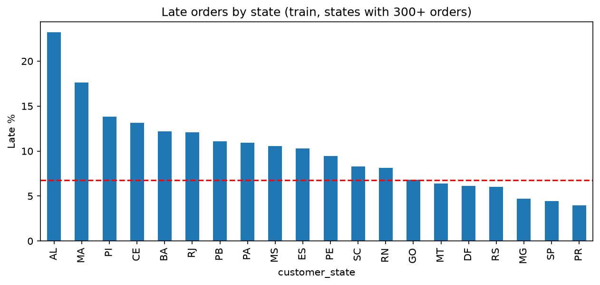
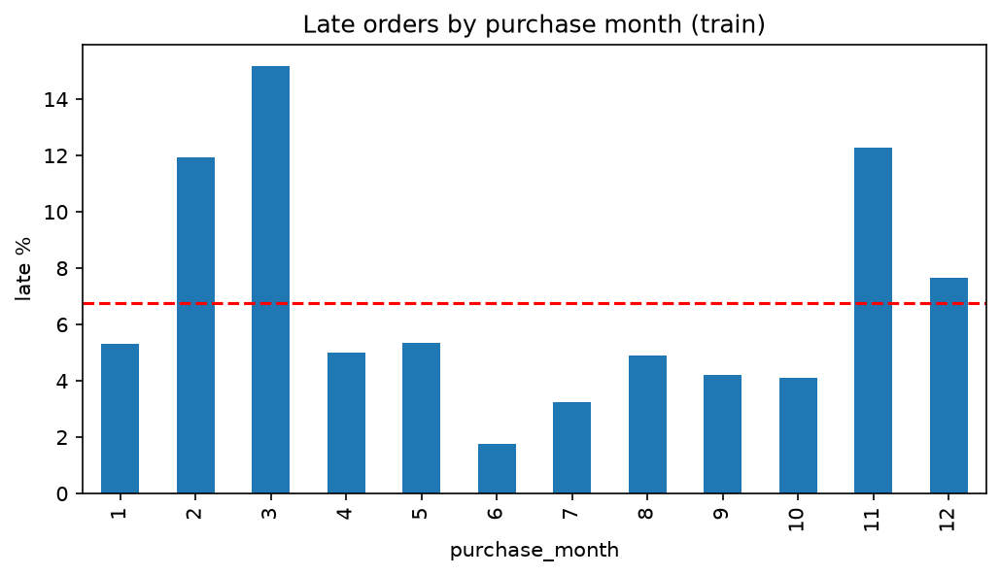
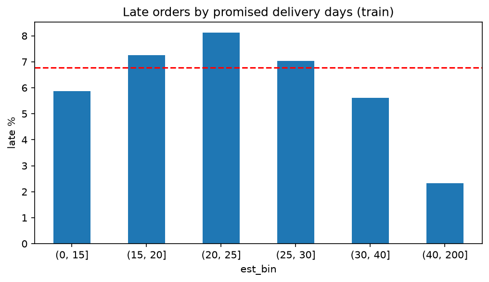
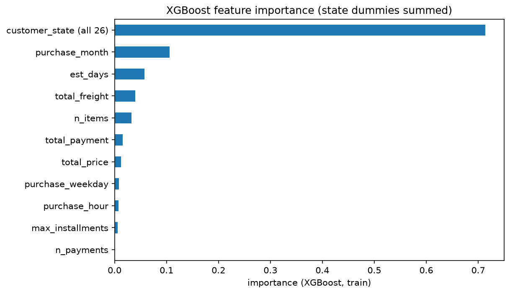

# Predicting Late Deliveries for Olist Orders (SQL + Python)

A small end-to-end project: raw CSV files -> SQLite database -> SQL cleaning and JOINs -> a cleaned table saved back to SQL -> EDA -> models that predict whether a delivered order will arrive after its estimated delivery date.

## TL;DR

- **Task:** binary classification. `is_late = 1` if the order was delivered after the estimated delivery date.
- **Class imbalance:** only 6.77% of orders are late. Accuracy is misleading here: always predicting "on time" gives 93.2% accuracy and catches zero late orders.
- **Best model:** XGBoost, test ROC-AUC **0.776** (Logistic Regression: 0.689).
- **At a probability threshold of 0.6 (test set):** it catches 53% of late orders with 20% precision and flags 17.9% of all orders. That is roughly 3x better than flagging at random, but about 4 out of 5 flags are still false alarms. The information available at purchase time gives a modest signal, not a strong one.

## Data

[Brazilian E-Commerce Public Dataset by Olist](https://www.kaggle.com/datasets/olistbr/brazilian-ecommerce) (Kaggle), about 100k orders from 2016 to 2018. The data files are **not included** in this repo (download them from Kaggle).

Tables used: `orders`, `customers`, `order_items`, `order_payments`. (The sellers table was loaded into the database but is not used in the model yet.)

## Pipeline

1. Load the CSV files into SQLite (`olist.db`) as `raw_*` tables, unchanged.
2. **SQL:** aggregate `order_items` and `order_payments` to one row per order (`GROUP BY order_id`) *before* joining, then `LEFT JOIN` onto orders and customers. Joining items directly would repeat an order once per item, which breaks counts and could put the same order in both train and test.
3. Keep only delivered orders that have a delivery date: 96,470 orders. One order had no payment record and was dropped, leaving **96,469**.
4. **pandas:** build the target and features, then save the result back to the database as the `clean_orders` table.
5. Read `clean_orders` back from SQL, split into train/test, run EDA on **train only**, train and evaluate models.

## Target and features

Predictions are meant to be made at **purchase time**, so only information known then is used.

- Target: `is_late` (delivered date > estimated date, compared by calendar day, not by time of day).
- Features: promised delivery days (`est_days` = estimated date minus purchase date), purchase month / weekday / hour, `customer_state`, number of items, total price, total freight, number of payments, total payment, max installments.
- Deliberately **excluded** because they are only known after the order is placed: delivered date, carrier date, review score.

## EDA (train set only)

State of the customer shows the strongest link with lateness (states with 300+ orders: from about 4% late in PR and SP to 23% in AL):

Month of purchase (about 1.7% late in June, 15.2% in March):

Promised delivery days: an inverted U, with the lowest late share for very long promises (2.3% for 40+ days):

## Modeling

- Stratified 80/20 split (`random_state=4`): 77,175 train / 19,294 test orders, 6.77% late in both.
- Encoding and scaling are done after the split. `customer_state` is one-hot encoded on train; Logistic Regression runs in a pipeline with `StandardScaler`.
- Imbalance is handled with `class_weight="balanced"` (Logistic Regression) and `scale_pos_weight` = 13.77 (XGBoost). Plain Logistic Regression has recall of about 0 (it almost never predicts "late").
- Hyperparameters were chosen on train only. XGBoost `max_depth` was picked from {2, 3, 4, 6} by CV ROC-AUC (0.758 to 0.769, differences within noise), so depth 3 was kept.

### Cross-validation on train (5-fold, "late" class)

| Model | ROC-AUC | Precision | Recall | F1 |
|---|---|---|---|---|
| Logistic Regression (balanced) | 0.685 | 0.116 | 0.616 | 0.195 |
| XGBoost | 0.766 | 0.156 | 0.672 | 0.253 |

### Choosing the threshold (train, out-of-fold predictions)

| Threshold | Precision | Recall | Orders flagged |
|---|---|---|---|
| 0.3 | 0.089 | 0.920 | 70.2% |
| 0.4 | 0.117 | 0.807 | 46.5% |
| 0.5 | 0.156 | 0.672 | 29.2% |
| **0.6** | 0.197 | 0.511 | 17.6% |
| 0.7 | 0.253 | 0.328 | 8.8% |
| 0.8 | 0.364 | 0.143 | 2.7% |

0.6 and 0.7 gave about the same F1; 0.6 was chosen because it keeps recall near 50%. The right threshold depends on how costly a false alarm is.

### Test set (evaluated once, after all choices were fixed)

| Model | ROC-AUC |
|---|---|
| Logistic Regression | 0.689 |
| XGBoost | **0.776** |

XGBoost at threshold 0.6: precision 0.200, recall 0.531, F1 0.291, 17.9% of orders flagged.

| | Predicted on time | Predicted late |
|---|---|---|
| Actually on time | 15,218 | 2,769 |
| Actually late | 613 | 694 |

Test and CV numbers are close, so there is no sign of leakage or overfitting to the test set. Note that accuracy at this threshold is 82.5%, lower than the 93.2% of "always on time", which is why precision, recall and AUC are reported instead.

## Feature importance (XGBoost, train)

| Feature | Importance |
|---|---|
| customer_state (26 dummies summed) | 0.714 |
| purchase_month | 0.106 |
| est_days | 0.058 |
| total_freight | 0.040 |
| n_items | 0.032 |
| total_payment | 0.016 |
| total_price | 0.012 |
| purchase_weekday | 0.008 |
| purchase_hour | 0.008 |
| max_installments | 0.006 |
| n_payments | 0.000 |

Caveat: summing 26 state columns makes state look bigger than a single numeric feature. Importance says what the model relies on, not what causes lateness.

## Limitations

- **Random split, not time-based.** A time-based split (train on older orders, test on newer ones) would be a stricter test and was not done.
- **Month effect may be period-specific.** The data covers only about two years, so a high-late month may reflect a particular event rather than a yearly pattern.
- **No seller location.** Customer state is probably acting as a rough stand-in for distance to the seller. Adding seller state or distance (the sellers and geolocation tables) is the most promising next step.
- The model only covers orders that were delivered; canceled or in-transit orders have no label.
- The signal is modest: most flagged orders are false alarms. Do not use it for costly decisions as is.
- Results come from one marketplace and one period.

## How to reproduce

1. Download the dataset from Kaggle and put the CSV files in the project folder.
2. Install: `pandas`, `numpy`, `scikit-learn`, `xgboost`, `matplotlib`.
3. Open `project.ipynb` and run all cells (the notebook builds `olist.db` itself).

## Files

- `project.ipynb`: the full workflow
- `late_by_state.png`, `late_by_month.png`, `late_by_est_days.png`, `feature_importance.png`: figures used above
